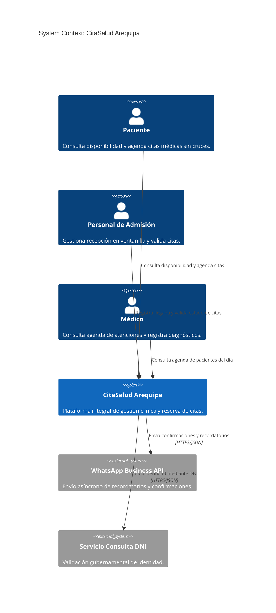

# CitaSalud Arequipa — Plataforma de Gestión de Citas Médicas

**Asignatura:** Construcción de Software (2026-B) — Escuela Profesional de Ingeniería de Sistemas, UNSA  
**Integrantes:**
* Velasque Arcos Mikhail Gabino
* Anco Aymara Jean Pierre

---

## Arquitectura C4 (Laboratorio 06)

En esta práctica se consolidó la arquitectura como modelo utilizando el **Modelo C4** (Simon Brown) y **Structurizr DSL**, integrando las decisiones de diseño del ADR-001 (Lab 04) y los diagramas estructurales y de comportamiento UML (Lab 05).

### 1. Diagrama de Contexto del Sistema (Mermaid C4)

---

## 2. Vistas de Arquitectura Generadas

Todas las vistas han sido exportadas automáticamente a partir de un único modelo unificado en `docs/architecture/c4/workspace.dsl`:

* **[Nivel 1: Contexto del Sistema](docs/architecture/c4/img/structurizr-Contexto.png)**: Usuarios, límites del sistema e integraciones externas.
* **[Nivel 2: Diagrama de Contenedores](docs/architecture/c4/img/structurizr-Contenedores.png)**: PWA (React), Monolito Modular (Django REST), PostgreSQL 16, Redis y Celery Worker.
* **[Nivel 3: Diagrama de Componentes](docs/architecture/c4/img/structurizr-Componentes.png)**: Módulos internos de la API (Auth, Disponibilidad, Reservas, Cancelaciones, Notificaciones).
* **[Vista Dinámica: Reserva de Cita Médica](docs/architecture/c4/img/structurizr-ReservaCita.png)**: Flujo crítico HU-01 con control de concurrencia y encolamiento asíncrono.
* **[Nivel Despliegue: Entorno Producción](docs/architecture/c4/img/structurizr-Despliegue.png)**: Dispositivos de usuario y Servidor VPS (Ubuntu 24.04, Docker Compose).

---

## 3. Artefactos del Laboratorio 06

* `docs/architecture/c4/inventario.md`: Inventario de elementos con trazabilidad hacia Labs 04 y 05.
* `docs/architecture/c4/workspace.dsl`: Modelo C4 unificado como código en Structurizr DSL.
* `docs/architecture/c4/contexto-manual.puml`: Diagrama de contexto redactado a mano con C4-PlantUML.
* `docs/architecture/c4/comparacion.md`: Estudio comparativo entre modelado unificado vs diagramación manual.
* `docs/architecture/c4/revision-c4.md`: Evaluación con checklist oficial de C4 y detección de falsos positivos de IA.
* `docs/architecture/c4/explicacion.md`: Síntesis de arquitectura en lenguaje no técnico para directivos clínicos.
* `docs/architecture/c4/bitacora-ia.md`: Registro de 5 interacciones con IA bajo el principio *"La IA propone, el equipo decide y verifica"*.
* `.github/workflows/c4-validation.yml`: Pipeline CI/CD que valida `workspace.dsl` con Structurizr CLI en cada push.

---

## 4. Etiqueta de Entrega

Hito inmutable de entrega: **`v0.6-c4`**
