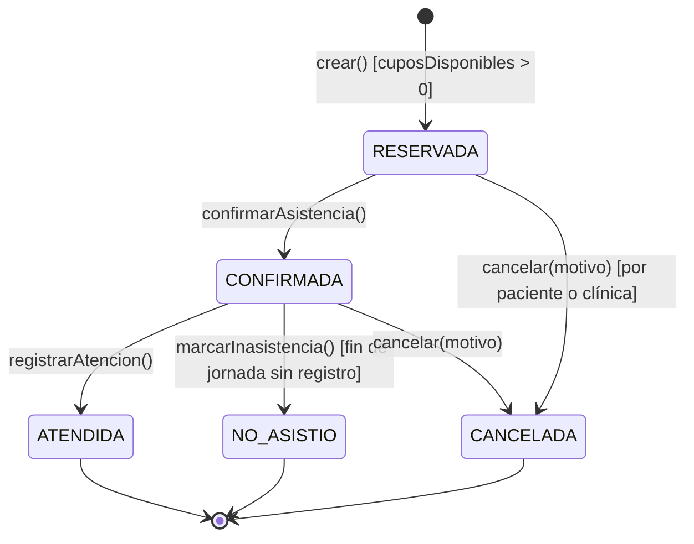

# Lab 04: Software Architecture - CitaSalud Arequipa

## 1. Datos Generales del Proyecto
* **Curso:** Arquitectura de Software (CS-2026b)
* **Tema:** Fundamentos de arquitectura de software: drivers, estilos arquitectónicos y decisiones documentadas con Diagrams as Code e IA.
* **Caso de Estudio:** CitaSalud Arequipa (Sistema Regional de Citas Médicas)
* **Grupo:** Grupo 02
* **Docente:** Ing. ALEXANDER JAVIER BENAVIDES ROJAS
* **Integrantes:**
  * Velasque Arcos Mikhail Gabino
  * Anco Aymara Jean Pierre
* **Enlace del Repositorio:** [GitHub - cs-2026b-lab04--grupo01](https://github.com/mvelasquea/cs-2026b-lab04--grupo01.git)

---

## 2. Fundamentos Teóricos de Arquitectura de Software
La arquitectura de software representa las estructuras de nivel superior de un sistema informático y la disciplina de crear dichas estructuras y sistemas. Sus pilares conceptuales aplicados en este laboratorio comprenden:

* **Drivers Arquitectónicos (Architectural Drivers):** Son las fuerzas determinantes que moldean la arquitectura, compuestas por los requisitos funcionales, las restricciones del negocio (plazos, presupuestos, tecnología) y, de manera crítica, los **atributos de calidad** (rendimiento, disponibilidad, modificabilidad, fiabilidad) que deben satisfacerse bajo escenarios específicos de seis partes (Fuente, Estímulo, Entorno, Artefacto, Respuesta y Medida).
* **Estilos Arquitectónicos y Desacoplamiento:** La elección de un estilo define cómo se distribuyen las responsabilidades y la comunicación entre componentes. Mientras que un monolito modular organiza lógicamente el código en dominios cohesivos con bajo acoplamiento interno, el uso de colas asíncroras permite aislar el procesamiento de tareas secundarias (como notificaciones masivas) para proteger el camino crítico transaccional.
* **Diagrams as Code (DaC):** Práctica que permite versionar, auditar y generar diagramas de arquitectura (como componentes, secuencia, actividad y despliegue) mediante código de programación (PlantUML / Mermaid), asegurando la trazabilidad junto al código fuente del sistema.
* **Toma de Decisiones Documentada (ADR y Matriz de Ponderación):** El diseño arquitectónico no busca soluciones perfectas, sino un balance justificado de contrapartes (*trade-offs*) evaluadas mediante criterios ponderados y registradas formalmente para mitigar la deuda técnica y los riesgos operacionales.

---

## 3. Resumen Ejecutivo del Caso: CitaSalud Arequipa
**CitaSalud Arequipa** es una plataforma regional diseñada para gestionar la reserva de citas médicas en los centros de salud de la región. El sistema resuelve un cuello de botella crítico: un pico masivo de **5,000 pacientes intentando reservar citas simultáneamente** entre las 7:00 y 7:15 a. m., exigiendo un tiempo de respuesta de $p95 \le 3\text{ s}$ y garantizando estrictamente **cero duplicidad de citas**. Todo esto bajo restricciones estrictas de un plazo de entrega de **1 mes de desarrollo**, un equipo pequeño y un presupuesto limitado a **un único servidor VPS**.

---

## 4. Arquitectura Seleccionada (Vista Principal)
Tras evaluar alternativas mediante una matriz de decisión ponderada, se seleccionó una arquitectura de **Monolito Modular con Procesamiento Asíncrono**. 

* **Camino Crítico Optimizado:** El flujo de reserva transaccional se procesa de manera síncrona y atómica contra la base de datos PostgreSQL con control estricto de concurrencia para evitar colisiones.
* **Procesamiento Asíncrono:** Las notificaciones de recordatorio por WhatsApp se desacoplan mediante una cola en **Redis/Celery**, evitando bloquear el servidor web principal durante el pico matutino.


---

## 5. Enlaces a los Entregables del Repositorio
Toda la documentación técnica del laboratorio se encuentra organizada en las siguientes rutas del repositorio:
* **[E1 - Drivers y Escenarios de Calidad](./docs/architecture/drivers.md):** Requisitos, atributos prioritarios y escenarios de calidad.
* **[E2 - Matriz de Decisión](./docs/architecture/matriz-decision.md):** Evaluación ponderada de alternativas generadas con IA.
* **[E3 y E5 - Código de Diagramas](./docs/architecture/diagramas/):** Archivos fuente Mermaid y PlantUML (componentes, secuencia, actividad, clases).
* **[E4 - ADRs (Registros de Decisiones Arquitectónicas)](./docs/architecture/adr/):** Decisiones clave sobre estilo, base de datos y colas.
* **[E6 - Vista de Despliegue](./docs/architecture/despliegue.py):** Script en Python para la generación del despliegue en el VPS.
* **[E7 - Bitácora de Uso de IA](./docs/architecture/bitacora-ia.md):** Registro detallado de prompts, respuestas y correcciones realizadas con la IA.

---

## 6. Reflexión sobre el Uso de Inteligencia Artificial
Durante el desarrollo de este laboratorio, la IA (ChatGPT y Claude) actuó como un copiloto técnico avanzado para:
1. **Generar escenarios y alternativas:** Acelerando la redacción inicial de los drivers de calidad y proponiendo estructuras de estilos arquitectónicos.
2. **Crítica adversarial ("Abogado del diablo"):** Permitió identificar puntos de ruptura ocultos, como la saturación del único VPS y el bloqueo de conexiones en PostgreSQL ante las 5,000 solicitudes concurrentes a las 7:00 a. m.
3. **Validación humana:** El equipo analizó críticamente cada propuesta de la IA, descartando arquitecturas sobrecomplicadas (como microservicios puros con Kubernetes) debido a la restricción absoluta del plazo de 1 mes de desarrollo.

## Diseño UML (Lab 05)

A continuación se presenta el diseño detallado del módulo de reservas para el MVP de CitaSalud Arequipa, elaborado aplicando Ingeniería de Modelos (Diagrams as Code) y asistencia de IA.

### Máquina de Estados: Ciclo de vida de la Cita



### Enlaces a la Documentación (Entregables E1 - E7)
- [E1] Historia de Usuario y Diagrama de Clases
- [E2] Diagrama de Secuencia - Flujo de Reserva
- [E3] Máquina de Estados (Archivo Fuente)
- [E4] Diagrama de Actividades - Flujo de Atención
- [E5] Diagrama de Paquetes - Monolito Modular
- [E6] Auditoría Round-trip (Ingeniería Inversa)
- [E7] Auditoría de Consistencia y Bitácora IA

### 2. Flujo de Pull Request (Revisión Cruzada)
Dado que usaste un *fork*, este proceso es muy sencillo:
1. Haz un `git push` de tus cambios a tu fork (`https://github.com/Jean159/cs-2026b-lab04--grupo01.git`).
2. Entra a GitHub, ve a tu repositorio y verás un botón verde que dice **"Compare & pull request"**. Haz clic ahí.
3. En la descripción escribe: *"Entrega del Lab 05. Por favor revisar reglas C1 a C5"*.
4. Tu compañero Mikhail debe entrar, revisar los archivos, dejar un comentario de aprobación y presionar **"Merge pull request"**.

### 3. Crear la Etiqueta de Entrega (Tag)
Una vez que el código esté unificado en el repositorio principal, desde tu terminal debes ejecutar estos comandos para sellar la entrega con la etiqueta que pide el profesor:

```bash
git tag v0.5-diseno
git push origin v0.5-diseno
```
